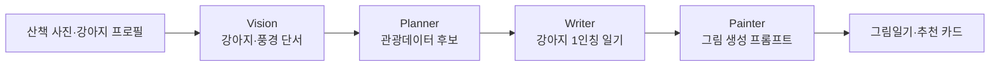
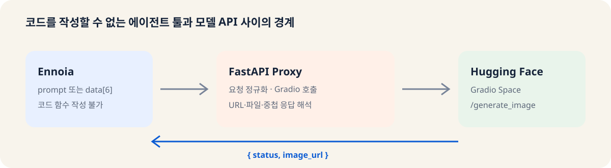
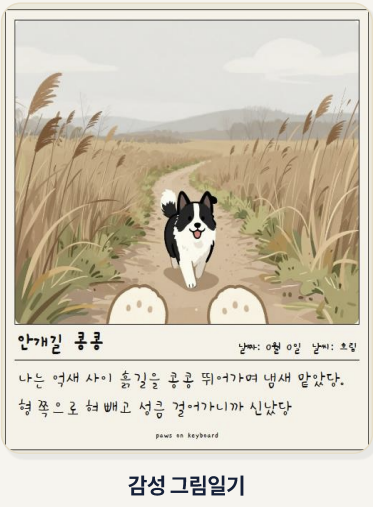
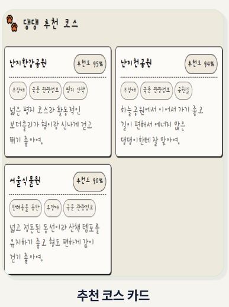

# Paws on Keyboard

사진 분석부터 관광지 추천, 일기 작성, 이미지 생성까지 이어지는 AI 에이전트 흐름을 맡았습니다. Ennoia에서 역할별 프롬프트를 연결하고, Hugging Face 이미지 생성 결과를 가져오는 FastAPI 프록시를 별도로 만들었습니다.

  

  산책 사진 한 장을 강아지 시점의 그림일기와 다음 산책 후보로 바꾸는 AI 에이전트 서비스

  <a href="docs/portfolio-ai-orchestration.md">AI 오케스트레이션 기록</a> ·
  <a href="https://github.com/kanghyunsoon/HF_ProxyAPI">Hugging Face 프록시</a>

  
  
  
  
  
  

> 2026 관광데이터 활용 공모전 · 생성형 AI 활용 관광 프롬프트 부문
>
> 팀 프로젝트 · 담당: 에이전트 구성, 프롬프트 작성, 외부 API 연동, 프록시 배포

## 맡은 일

| 영역 | 담당 내용 | 사용 기술 |
| --- | --- | --- |
| AI 오케스트레이션 | 사진 분석, 관광지 탐색, 일기 작성, 이미지 생성 역할과 전달 순서 구성 | Ennoia |
| 외부 API 파이프라인 | 반려동물 동반·무장애·두루누비·TourAPI 데이터를 추천 근거로 연결 | 한국관광공사 OpenAPI |
| 이미지 생성 연결 | Ennoia 요청을 Gradio 입력으로 바꾸고 결과를 이미지 URL로 반환 | FastAPI, Python, Gradio Client |
| 프롬프트 조정 | 사진 단서, 강아지 프로필, 추천 근거를 다음 단계에 전달하도록 출력 항목 지정 | 역할별 프롬프트 |

## 1. 사진 분석부터 이미지 생성까지 네 역할로 나눴습니다

원하는 그림 형식이 유지되지 않거나 추천 이유가 빠지는 문제를 확인하며 프롬프트를 조정했습니다. 각 단계에서 확인할 내용을 나누기 위해 Vision, Planner, Writer, Painter의 입력과 출력 항목을 정했습니다.

Vision에는 사진 속 강아지와 배경을 분석하게 하고, Planner에는 관광지 후보와 추천 근거를 요청했습니다. Writer는 사진과 프로필을 바탕으로 강아지 시점의 일기를 쓰고, Painter는 그 내용을 그림 생성 프롬프트로 바꾸도록 했습니다.

출력을 확인할 때도 추천 이유는 Planner, 일기 문장은 Writer, 그림 조건은 Painter에서 수정했습니다. 일기는 두 문장으로 제한하고, 추천 카드에는 데이터 출처와 선택 이유를 넣도록 했습니다.

## 2. Ennoia와 Hugging Face 사이에 프록시를 두었습니다

사용한 Ennoia 툴에는 요청 변환 코드를 작성하는 기능이 없었습니다. Hugging Face Gradio Space가 요구하는 배열을 만들고 응답 파일을 처리할 수 없어, 프롬프트를 만들어도 이미지 결과를 화면으로 가져오지 못했습니다.

이 부분은 Python과 FastAPI로 서버를 만들어 연결했습니다. Ennoia가 프롬프트를 보내면 서버가 Gradio의 인자 순서에 맞춰 호출하고, 결과를 `image_url`로 돌려주도록 했습니다.

응답에 URL이 있으면 그대로 사용하고, 서버에 내려받은 파일이면 브라우저에서 읽을 수 있는 주소로 제공했습니다. 배열이나 객체에 담긴 결과도 탐색하도록 했으며, 이미지 값을 찾지 못하면 오류를 반환합니다. 구현은 [HF_ProxyAPI](https://github.com/kanghyunsoon/HF_ProxyAPI)에 정리했습니다.

## 3. 산책 장소를 추천할 때 공공데이터를 참고하게 했습니다

반려견 동반 여부와 이동 편의 정보를 추천에 반영하기 위해 한국관광공사 데이터를 연결했습니다. Planner에는 데이터별로 어떤 정보를 확인할지 지정했습니다.

| 데이터 | 사용한 근거 |
| --- | --- |
| 반려동물 동반 여행 서비스 | 반려동물 동반 가능 시설과 산책 후보 |
| 무장애 관광정보 API | 노견, 펫 유모차, 보호자 이동 편의 |
| 두루누비 걷기길 데이터 | 산책로와 걷기 후보 |
| 국문 관광정보 TourAPI | 관광지 명칭, 위치, 상세 정보 |

추천 카드에는 장소명과 함께 출처, 선택 이유를 표시했습니다. API 응답을 참고해 문장을 생성하는 방식이므로, 실제 방문 전 시설의 동반 조건과 운영 여부를 확인해야 합니다.

## 결과 화면

<table>
  <tr>
    <td width="50%" align="center"></td>
    <td width="50%" align="center"></td>
  </tr>
  <tr>
    <td align="center">사진 단서와 프로필을 반영한 그림일기</td>
    <td align="center">공공데이터 근거를 표시한 추천 카드</td>
  </tr>
</table>

화면의 추천도는 서비스 표시값이며, 추천 정확도를 측정한 수치는 아닙니다.

## 현재 한계

- Ennoia에 애플리케이션 코드 내보내기 기능이 없어 서비스 화면과 구성 기록을 남겼습니다. 별도로 작성한 프록시 코드는 공개했습니다.
- 모델 품질과 응답 시간, 사용자 평가를 측정한 기록은 없습니다.
- 프록시에는 요청 제한과 재시도가 없습니다. 생성 파일은 하루가 지나면 지웁니다. Space의 함수나 응답 형식이 바뀌면 연동 코드도 확인해야 합니다.

## 코드와 설계 기록

- [AI 에이전트 오케스트레이션과 프록시 설계](docs/portfolio-ai-orchestration.md)
- [실제 프록시 구현](https://github.com/kanghyunsoon/HF_ProxyAPI/blob/main/main.py)
