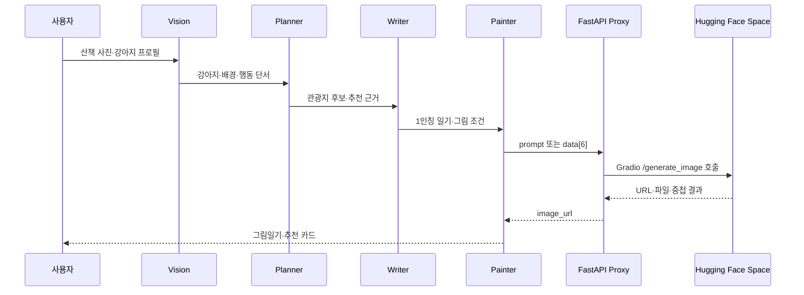

# AI 에이전트 오케스트레이션과 프록시 설계

## 결론

Paws on Keyboard에서 맡은 일은 네 에이전트의 입력과 출력을 연결하고, Ennoia가 직접 호출하지 못한 Hugging Face Gradio Space를 프록시 서버로 연결한 것이다.

서비스는 Ennoia 안에서 구현됐기 때문에 완성된 애플리케이션 소스가 export되지 않았다. 이 문서는 발표 화면, 프롬프트 구조, 별도 프록시 코드에서 확인되는 기술 판단을 기록한다.

## 담당 범위

| 구분 | 담당 |
| --- | --- |
| AI 흐름 | Vision → Planner → Writer → Painter 순서와 전달 데이터 설계 |
| 프롬프트 | 사진 단서, 강아지 프로필, 관광지 근거를 역할별 프롬프트로 분리 |
| 외부 API | 한국관광공사 데이터 4종의 용도와 추천 근거 설계 |
| 이미지 생성 | Ennoia → FastAPI → Hugging Face Space 호출 경계 구현 |
| 배포 | Ennoia가 호출할 수 있는 HTTP 프록시 서버 배포 |

## 에이전트 전달 구조



### Vision

사진에서 다음 단계가 사용할 사실만 추출한다.

- 강아지 존재와 외형 단서
- 산책 장소와 배경
- 행동과 감정 단서
- 그림에 유지할 색과 구도

### Planner

관광데이터 후보를 검색하고 추천 근거를 만든다.

- 반려동물 동반 가능 여부
- 무장애 이동 정보
- 걷기길 정보
- 관광지 명칭과 위치

### Writer

사진 분석 결과와 강아지 프로필을 합쳐 1인칭 일기를 작성한다. 사진에 없는 장소나 행동을 추가하지 않고, 보호자 호칭과 강아지 성격을 문장에 반영하도록 제한했다.

### Painter

그림일기 스타일, 강아지 외형, 사진 배경을 이미지 생성 프롬프트로 바꾼다. 글자와 말풍선을 이미지 안에 생성하지 않도록 제외 조건도 함께 전달했다.

## 문제 1. 에이전트 출력이 다음 단계에서 흔들렸다

### 관찰한 문제

- 이미지가 크레용 그림이 아니라 실사나 종이 사진처럼 생성됨
- 코스 카드에 HTML 조각이 일반 텍스트로 노출됨
- 추천 장소는 나오지만 선택 근거가 빠짐

### 적용한 방법

역할별로 출력 범위를 줄이고 다음 단계에 필요한 값만 전달했다.

| 단계 | 전달해야 하는 값 | 전달하지 않는 값 |
| --- | --- | --- |
| Vision | 사진 속 객체·색·행동·장소 | 관광지 추천 문장 |
| Planner | 후보 장소·데이터 출처·추천 이유 | 일기 문체 |
| Writer | 제목·2문장 일기·감정 | HTML 레이아웃 |
| Painter | 그림 조건·제외 조건 | 화면 카드 마크업 |

문장 생성과 화면 구조를 분리해 HTML이 본문에 섞이는 경로를 줄였다. 추천 이유에는 어떤 관광데이터를 사용했는지 포함하도록 Planner 출력 조건을 고정했다.

## 문제 2. Ennoia가 Hugging Face 규격을 직접 만들 수 없었다

### 제약

Hugging Face Gradio Space는 여섯 값을 순서대로 담은 요청과 `/generate_image` 호출을 사용한다. 응답은 URL일 수도 있고, 서버가 내려받은 로컬 파일 경로나 중첩 객체일 수도 있다.

Ennoia에서는 이 변환과 분기 처리를 코드 함수로 작성할 수 없어, 프롬프트 생성 이후 이미지를 서비스 화면까지 가져올 경계가 필요했다.

### 프록시 계약

프록시는 두 요청 형태를 하나의 내부 모델로 정규화한다.

```json
{
  "prompt": "dog picture diary in crayon style",
  "width": 768,
  "height": 1024,
  "guidance_scale": 8,
  "seed": 1234,
  "randomize_seed": false
}
```

```json
{
  "data": [
    "dog picture diary in crayon style",
    768,
    1024,
    8,
    1234,
    false
  ]
}
```

호출 결과는 `str`, `dict`, `list`, `tuple`을 재귀 탐색한다. 객체에서는 `url`, `path`, `name`, `file`, `image` 키를 우선 확인한다. 결과가 로컬 파일이면 UUID 파일명으로 복사해 `/outputs` 정적 경로로 제공한다.

Ennoia가 사용하는 값은 다음과 같다.

```json
{
  "status": "success",
  "image_url": "https://proxy.example.com/outputs/uuid.png"
}
```

구현은 [HF_ProxyAPI](https://github.com/kanghyunsoon/HF_ProxyAPI) 저장소에 분리했다. 모델이나 Gradio 응답이 바뀌어도 Ennoia 쪽 프롬프트 흐름을 수정하지 않고 프록시에서 대응하기 위한 선택이다.

## 문제 3. 추천 문장에 근거가 보이지 않았다

장소 이름과 추천 문장만 생성하면 실제 관광데이터를 사용했는지 확인할 수 없다. Planner가 데이터 종류별 역할을 구분하고 추천 카드에 근거를 함께 넘기도록 했다.

| 데이터 | 판단에 사용한 항목 |
| --- | --- |
| 반려동물 동반 여행 서비스 | 반려동물 동반 가능 시설 |
| 무장애 관광정보 API | 보행, 펫 유모차, 보호자 이동 편의 |
| 두루누비 걷기길 데이터 | 산책로와 걷기 후보 |
| 국문 관광정보 TourAPI | 장소명, 위치, 상세 정보 |

## 확인 결과

- 네 에이전트의 출력이 그림일기와 추천 카드의 어느 영역에 쓰이는지 분리했다.
- Ennoia가 한 번의 POST 요청으로 Hugging Face 이미지 URL을 받을 수 있게 했다.
- 추천 카드에 반려동물 동반, 이동 편의, 걷기길 근거를 표시했다.
- 이미지 스타일, HTML 노출, 추천 근거 누락을 각각 프롬프트·화면·데이터 경계 문제로 나눠 수정했다.

## 측정하지 않은 것

- 이미지 품질 점수와 사용자 선호도
- 에이전트별 응답 시간과 전체 p95 지연
- 관광지 추천의 정답률
- 동시 요청 수와 장애 복구 시간

측정 기록이 없는 항목은 성과 수치로 사용하지 않았다.
