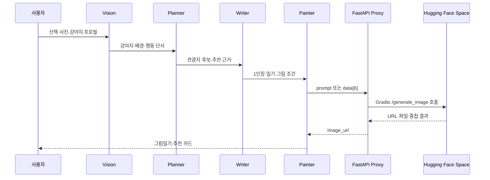

# AI 에이전트 오케스트레이션과 프록시 설계

Paws on Keyboard에서 사진 분석·장소 추천·일기 작성·이미지 생성을 연결하는 흐름을 맡았습니다. Ennoia에서 프롬프트와 전달 항목을 조정했고, 툴에서 처리할 수 없던 Hugging Face 요청은 FastAPI 서버를 만들어 연결했습니다.

Ennoia에는 애플리케이션 코드를 내보내는 기능이 없어 서비스 화면과 구성 기록을 남겼습니다. 별도로 작성한 프록시 코드는 [HF_ProxyAPI](https://github.com/kanghyunsoon/HF_ProxyAPI)에 있습니다.

## 담당 범위

| 구분 | 담당 |
| --- | --- |
| AI 흐름 | Vision → Planner → Writer → Painter 순서와 전달 항목 구성 |
| 프롬프트 | 사진 단서, 강아지 프로필, 관광지 근거를 역할별 프롬프트로 분리 |
| 외부 API | 한국관광공사 데이터 4종을 추천에 연결 |
| 이미지 생성 | Ennoia → FastAPI → Hugging Face Space 호출 연결 |
| 배포 | Ennoia가 호출할 수 있는 HTTP 프록시 서버 배포 |

## 에이전트 전달 구조



### Vision

다음 단계에서 참고할 사진 단서를 추출하도록 요청했습니다.

- 강아지 존재와 외형 단서
- 산책 장소와 배경
- 행동과 감정 단서
- 그림에 유지할 색과 구도

### Planner

관광데이터에서 후보를 찾고 추천 근거를 작성하도록 했습니다.

- 반려동물 동반 가능 여부
- 무장애 이동 정보
- 걷기길 정보
- 관광지 명칭과 위치

### Writer

사진 분석 결과와 강아지 프로필을 바탕으로 두 문장의 일기를 쓰도록 했습니다. 사진에 없는 장소나 행동을 추가하지 말고, 보호자 호칭과 강아지 성격을 문장에 반영하도록 프롬프트에 조건을 넣었습니다.

### Painter

강아지 외형과 사진 배경을 그림 생성 프롬프트로 바꾸도록 했습니다. 이미지 안에 글자와 말풍선이 생기지 않도록 제외 조건을 함께 전달했습니다.

## 1. 출력 항목을 나누고 결과를 보며 프롬프트를 수정했습니다

### 관찰한 문제

- 이미지가 크레용 그림이 아니라 실사나 종이 사진처럼 생성됨
- 코스 카드에 HTML 조각이 일반 텍스트로 노출됨
- 추천 장소는 나오지만 선택 근거가 빠짐

### 적용한 방법

역할별로 다음 단계에 넘길 항목을 정했습니다.

| 단계 | 전달해야 하는 값 | 전달하지 않는 값 |
| --- | --- | --- |
| Vision | 사진 속 객체·색·행동·장소 | 관광지 추천 문장 |
| Planner | 후보 장소·데이터 출처·추천 이유 | 일기 문체 |
| Writer | 제목·2문장 일기·감정 | HTML 레이아웃 |
| Painter | 그림 조건·제외 조건 | 화면 카드 마크업 |

Writer에는 일기 문장을, Painter에는 그림 조건을 요청하도록 나눴습니다. Planner에는 추천 이유와 사용한 관광데이터를 함께 넘기도록 했습니다. 수정한 뒤 서비스 화면에서 그림 형식, 일기 문장, 추천 근거를 확인했습니다. 생성 결과의 오류율을 비교 측정한 기록은 없습니다.

## 2. 요청 변환과 이미지 파일 처리는 프록시로 옮겼습니다

### 제약

연결한 Hugging Face Gradio Space는 여섯 값을 순서대로 담아 `/generate_image`를 호출해야 했습니다. 결과도 URL, 서버에 내려받은 파일, 배열이나 객체 등으로 반환될 수 있었습니다.

사용한 Ennoia 툴에서는 이 처리를 코드 함수로 작성할 수 없었습니다. 그래서 FastAPI 서버가 Gradio를 호출하고, Ennoia가 사용할 이미지 URL을 반환하도록 만들었습니다.

### 요청과 응답 처리

프롬프트를 담은 객체와 Gradio 형식의 배열을 모두 받도록 했습니다. 두 요청은 서버에서 같은 여섯 입력값으로 변환합니다.

```json
{
  "prompt": "dog picture diary in crayon style",
  "width": 768,
  "height": 1024,
  "guidance_scale": 8,
  "seed": 1234,
  "randomize_seed": false
}
```

```json
{
  "data": [
    "dog picture diary in crayon style",
    768,
    1024,
    8,
    1234,
    false
  ]
}
```

호출 결과에서 URL이나 파일 경로를 찾도록 했습니다. 객체에서는 `url`, `path`, `name`, `file`, `image` 항목을 먼저 확인하고, 배열 안에 결과가 있으면 내부 항목을 탐색합니다. 로컬 파일은 Gradio가 결과를 내려받는 폴더 안의 이미지 파일만 UUID 파일명으로 옮겨 `/outputs` 경로로 제공하고, 서버의 다른 파일 경로는 거부합니다. 이미지 값을 찾지 못하면 오류를 반환합니다.

Ennoia는 성공 응답의 `image_url`을 사용합니다. 아래는 원본 결과를 담은 `raw_result`를 생략한 예시입니다.

```json
{
  "status": "success",
  "image_url": "https://proxy.example.com/outputs/uuid.png"
}
```

Ennoia에는 프롬프트와 URL을 주고받는 부분을 두고, Gradio 인자 순서와 파일 처리는 프록시에서 관리했습니다.

## 3. 추천 카드에 데이터 출처와 이유를 표시했습니다

반려견 동반 여부와 이동 편의 정보를 추천에 반영하기 위해, Planner가 조회할 관광데이터와 출력 항목을 정했습니다.

| 데이터 | 판단에 사용한 항목 |
| --- | --- |
| 반려동물 동반 여행 서비스 | 반려동물 동반 가능 시설 |
| 무장애 관광정보 API | 보행, 펫 유모차, 보호자 이동 편의 |
| 두루누비 걷기길 데이터 | 산책로와 걷기 후보 |
| 국문 관광정보 TourAPI | 장소명, 위치, 상세 정보 |

추천 카드에서 장소명, 데이터 출처, 추천 이유를 함께 확인하도록 구성했습니다. 화면에 표시한 추천도는 서비스 표시값이며, 사용자 평가로 측정한 정확도는 아닙니다.

## 남은 부분

이미지 품질, 추천 정확도, 응답 시간은 별도로 측정하지 않았습니다. 프록시에는 재시도와 요청 제한이 없고, 생성 파일은 하루가 지나면 지웁니다. 공모전에서 서비스 흐름을 연결한 범위까지 기록했습니다.
